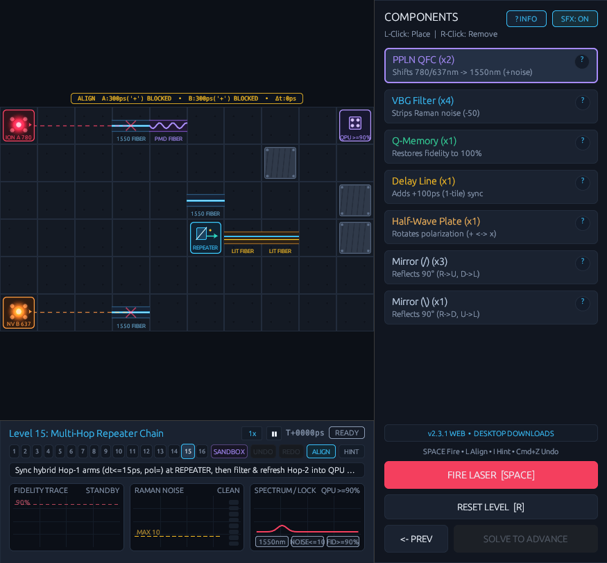
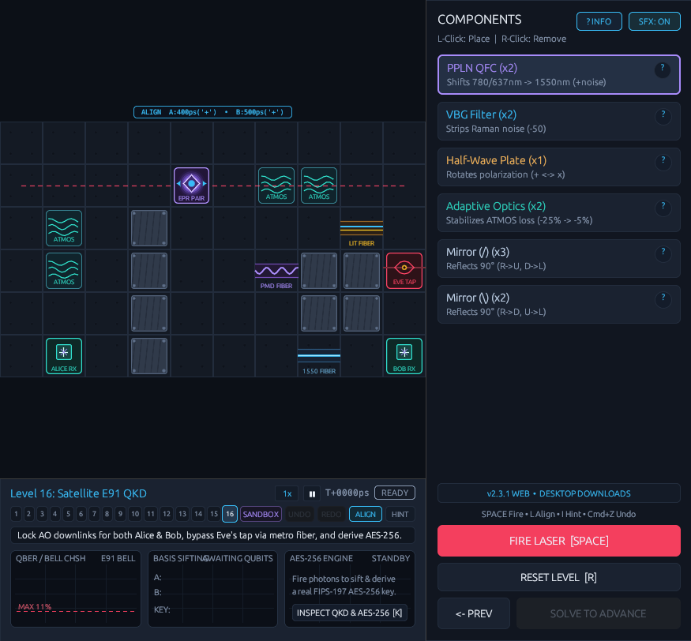
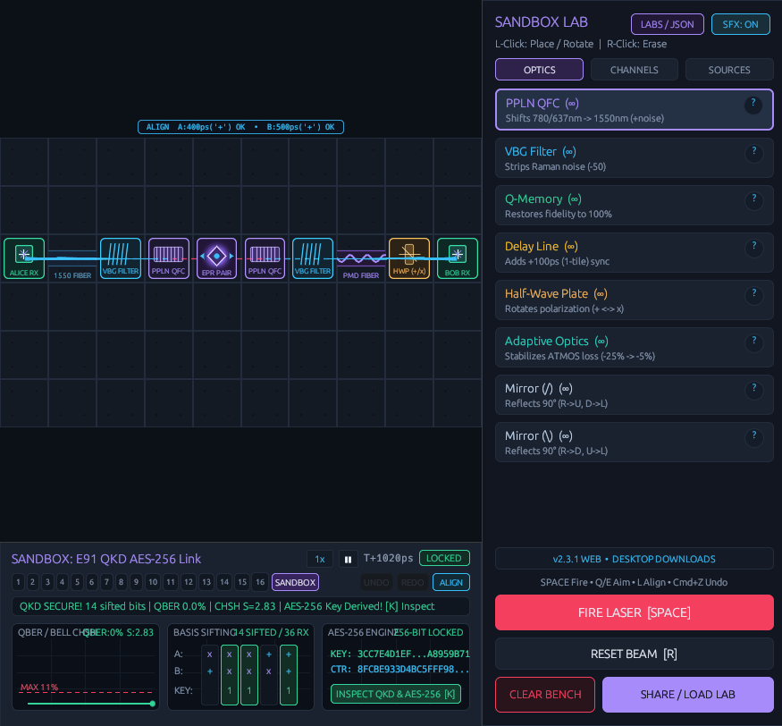
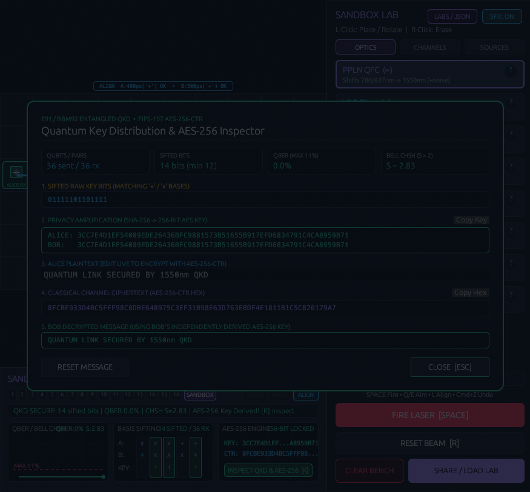

# QN Bench — Quantum Networking Optical Bench

An educational 2D optical-bench puzzle game built in **Rust + `eframe`/`egui`** (compiling to **WebAssembly**, **macOS Universal**, and **Windows x64**) that teaches the real physics and hardware stack of quantum networking — single-photon transduction (`780nm`/`637nm` → `1550nm`), Raman noise filtering, quantum memories, Hong-Ou-Mandel (HOM) interference, polarization mode dispersion, entanglement distillation, adaptive optics satellite downlinks, and end-to-end **BB84 / E91 QKD + FIPS-197 AES-256** cryptography.

## Play in Browser or Download

* **▶ Play Instantly in Browser (WebAssembly):** https://skcalanderson2.github.io/qn_bench/play/
* **Download Page:** https://skcalanderson2.github.io/qn_bench/
* **GitHub Releases:** https://github.com/skcalanderson2/qn_bench/releases/latest

* **macOS Universal (Apple Silicon & Intel):** Download `QN-Bench-*-macos-universal.dmg` (signed with Apple Developer ID and notarized by Apple) and drag `QN Bench.app` into `Applications`.
* **Windows (10/11 x64):** Download `QN-Bench-*-windows-x64-setup.exe` (per-user installer, no admin needed) or the portable `QN-Bench-windows-x64.zip`. *(Unsigned build: if Windows SmartScreen prompts on first launch, click **More info → Run anyway**.)*

### In-App Self-Updating (Desktop)
Native macOS and Windows builds check GitHub Releases in the background on startup (or manually via the sidebar version pill / `U` key). When a newer release is available, QN Bench displays the release notes and asks for your permission before downloading, verifying SHA-256 (plus Apple Developer `TeamIdentifier` on macOS), swapping the bundle, and relaunching.

---

## Screenshots

| Level 1: Wavelength Transduction & Alignment Laser | Level 4: Entanglement Swapping (HOM) |
| --- | --- |
|  |  |

| Level 15: Heralded Multi-Hop Repeater Chain | Level 16: Satellite E91 QKD Grand Finale |
| --- | --- |
|  |  |

| Free-Build Sandbox & Shareable URLs | Live FIPS-197 AES-256 Cryptography Inspector |
| --- | --- |
|  |  |

---

## Building from Source (Rust)

```bash
# Run native desktop app
cargo run --release

# Run physics & NIST FIPS-197 AES-256 test suite (all 16 levels + Sandbox)
cargo test

# Run locally in browser (WebAssembly via Trunk)
trunk serve --public-url /
```

*(The original Python + Pygame `v1.1.0` prototype is preserved on the `python-v1` branch.)*

### Controls
* **L-Click** — Place selected component (or rotate an emitter in Sandbox Mode)
* **R-Click** — Remove placed component
* **Shift+Click / Middle-Click** — Inspect any hardware tile's full Physics Specification (`?`)
* **SPACE** — Fire single photon(s) / QKD burst
* **Enter** — Advance to next level after solving
* **L** — Toggle **Live Alignment Laser** (real-time beam routing, absorption hazard markers, and picosecond path-length/polarization sync HUD)
* **I** — Open **Progressive 2-Tier Hint** (Physics Nudge → optional Tactical Hint)
* **Cmd/Ctrl+Z** / **Cmd/Ctrl+Shift+Z** — Undo / Redo optical bench edits (Campaign & Sandbox)
* **S** — Toggle **Interactive Free-Build Sandbox Mode** (unlimited optics, channels, rotatable emitters, EPR/QKD labs, & JSON blueprint sharing)
* **Q / E** — Rotate emitter aim direction in Sandbox Mode
* **P** — Pause / resume simulation (use `0.5x` / `1x` / `2x` pill to adjust speed)
* **R** — Reset current level (or stop/reset beam in Sandbox Mode)
* **H** — Open Experiment Briefing (or Sandbox Templates / JSON Blueprints modal)
* **K** — Open QKD & AES-256 Inspector (on Levels 12–14, 16, or Sandbox QKD benches)
* **U** — Check for software updates (desktop)
* **M** — Mute / unmute procedural lab audio
* **1–9, 0, -, [ / ]** — Switch campaign levels
