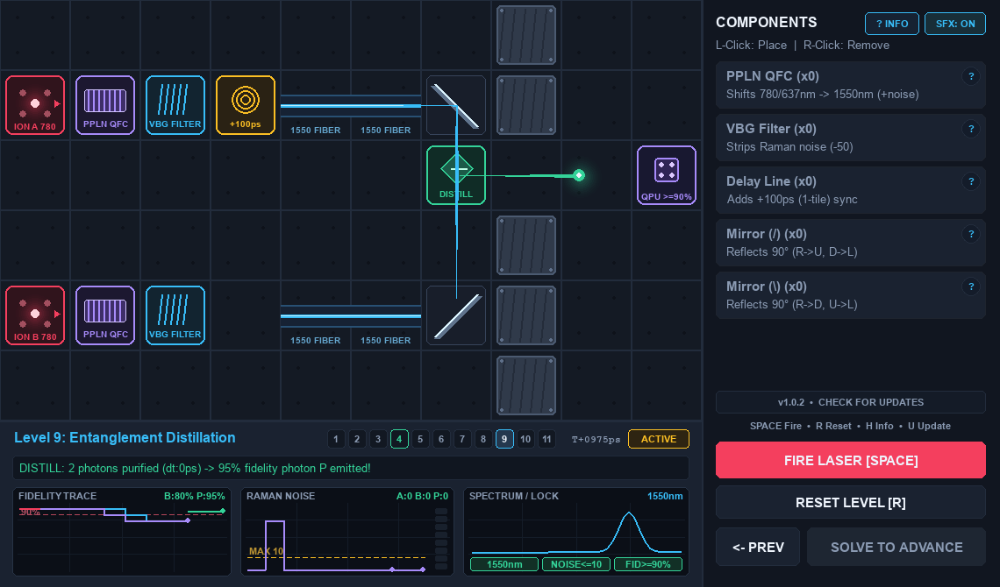
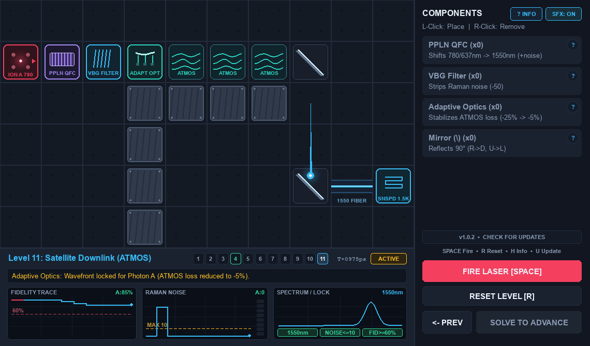
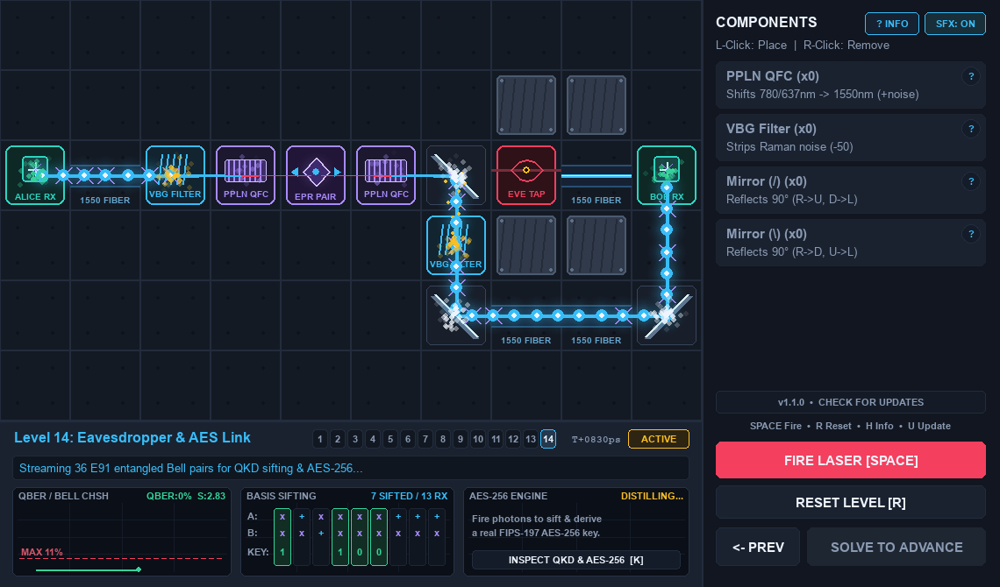

# QN Bench — Quantum Networking Optical Bench

An educational 2D optical-bench puzzle game built in **Python + Pygame** that teaches the real physics and hardware stack of quantum networking — single-photon transduction (`780nm`/`637nm` → `1550nm`), Raman noise filtering, quantum memories, Hong-Ou-Mandel (HOM) interference, polarization mode dispersion, entanglement distillation, and adaptive optics satellite downlinks.

## Download (macOS & Windows)

* **Download Page:** https://skcalanderson2.github.io/qn_bench/
* **GitHub Releases:** https://github.com/skcalanderson2/qn_bench/releases/latest

* **macOS (Apple Silicon):** Download `QN-Bench-*-macos-arm64.dmg` (signed with an Apple Developer ID certificate and notarized by Apple) and drag `QN Bench.app` into `Applications`.
* **Windows (10/11 x64):** Download `QN-Bench-*-windows-x64-setup.exe` (per-user installer, no admin needed) or the portable `QN-Bench-windows-x64.zip`. *(Unsigned build: if Windows SmartScreen prompts on first launch, click **More info → Run anyway**.)*

### In-App Self-Updating
`QN Bench` automatically checks GitHub Releases in the background on startup (or manually via the sidebar version pill / `U` key). When a newer release is available, it displays the release notes and asks for your permission before downloading, verifying the SHA-256 digest (plus Apple Developer signature `TeamIdentifier` on macOS), swapping the bundle, and relaunching.

---

## Screenshots

| Level 1: Wavelength Transduction & Filtering | Level 4: Entanglement Swapping (HOM) |
| --- | --- |
|  |  |

| Level 9: Entanglement Distillation | Level 11: Satellite Downlink (ATMOS) |
| --- | --- |
|  |  |

| Level 14: Entangled E91 QKD & Eve Detection | Live FIPS-197 AES-256 Cryptography Inspector |
| --- | --- |
|  |  |

---

## Running from Source

```bash
python3 -m venv .venv
.venv/bin/pip install pygame certifi
.venv/bin/python3 qn_bench.py
```

### Controls
* **L-Click** — Place selected optical component
* **R-Click** — Remove placed component
* **SPACE** — Fire single photon(s)
* **R** — Reset current level
* **H** — Open Experiment Briefing overlay
* **K** — Open QKD & AES-256 Inspector (on Levels 12–14)
* **U** — Check for software updates
* **M** — Mute / unmute procedural lab audio
* **1–9, 0, -, [ / ]** — Switch levels

---

